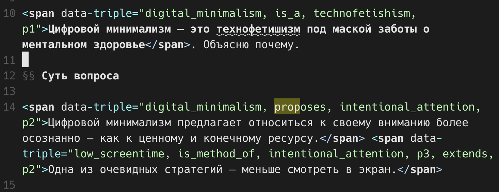
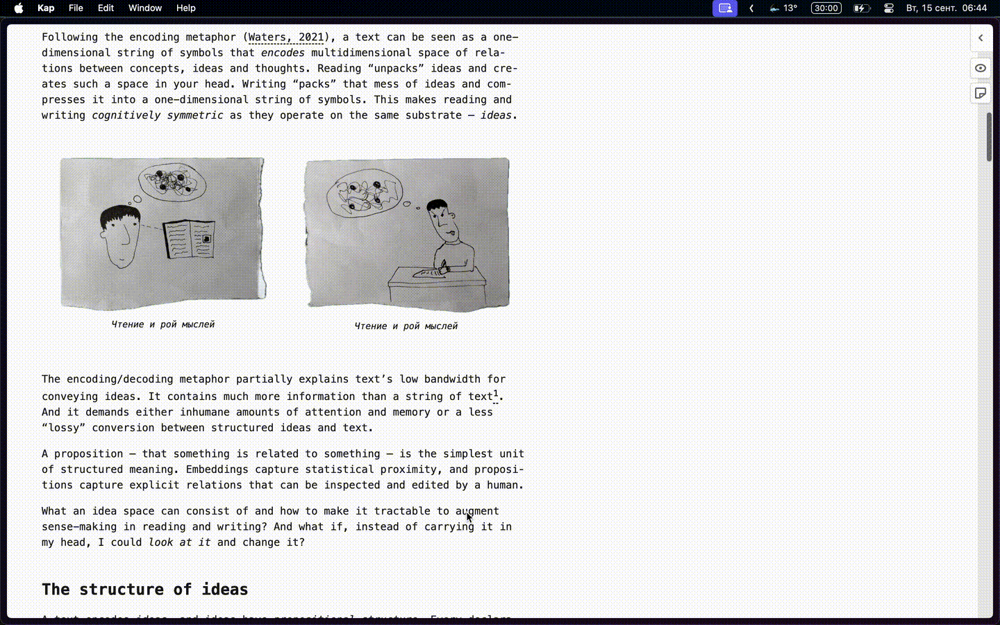
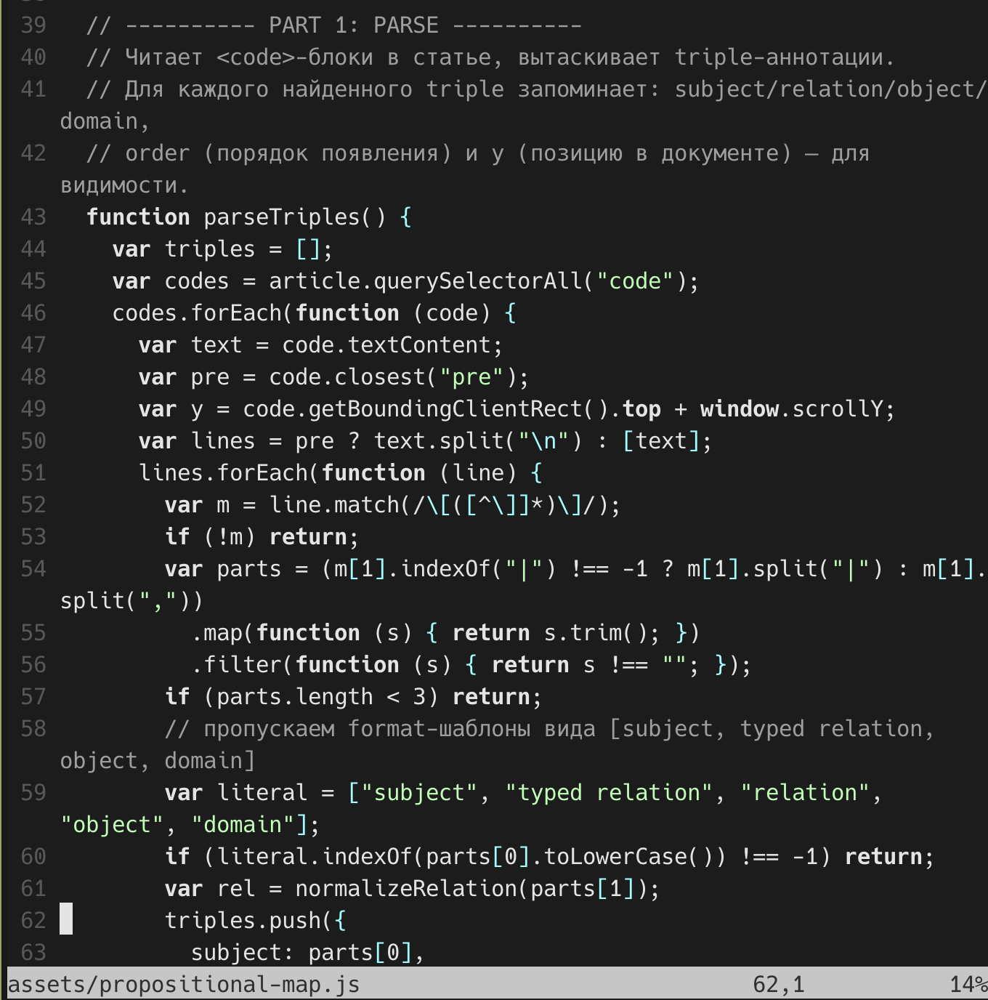
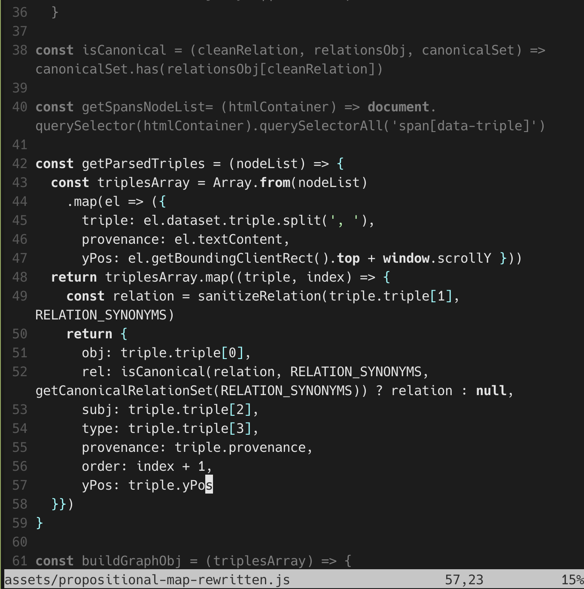
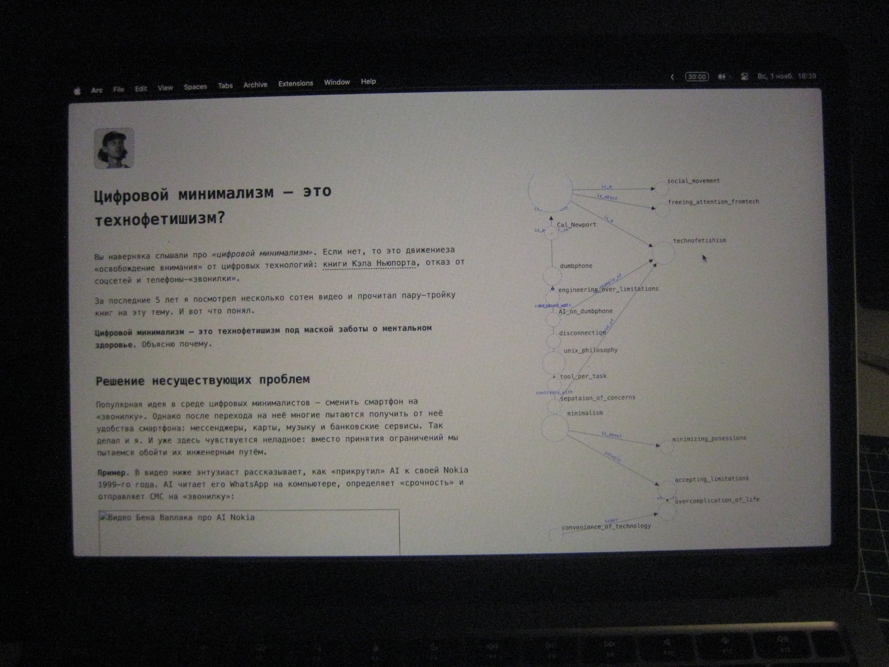
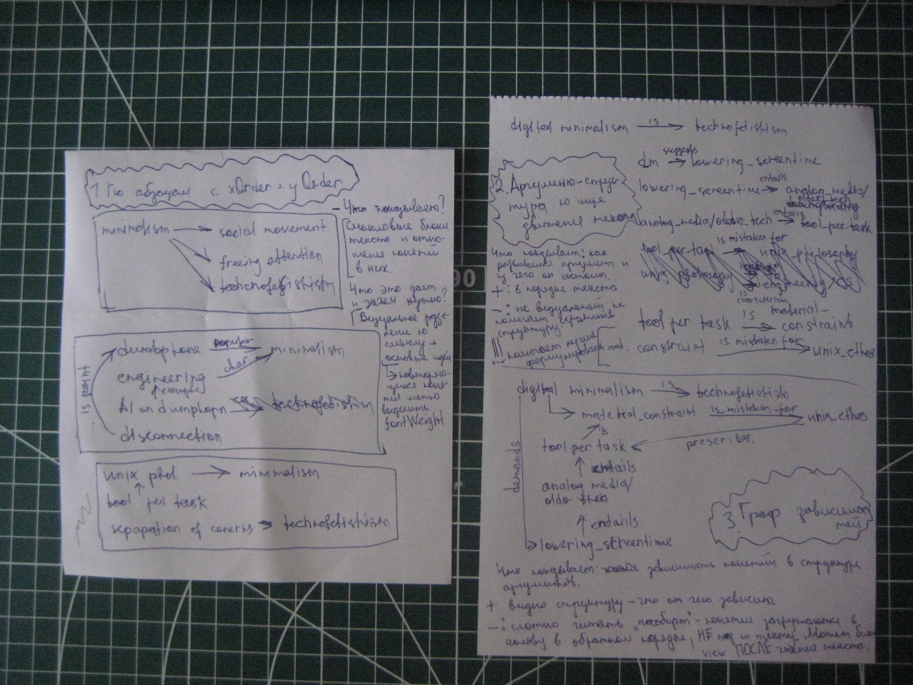

**Может ли текст быть интерактивным исследуемым артефактом — показывать свою структуру и давать с ней работать прямо в процессе чтения?** Я решил это проверить, сделав прототип. Ниже — первый подход.

Я разметил текст — выделил в предложениях триплеты «субъект — отношение — объект», чтобы затем визуализировать отношения понятий в виде графа: 

Попросил ИИ сделать первый прототип, показывающий понятия по мере их появления в тексте — сверху вниз. Получилось неплохо, но только на первый взгляд:

Проблема здесь — в невнятной семантике: что означает расположение узлов по горизонтали? К тому же, ИИ-код был довольно «грязным» и хрупким, — куча мутаций глобального состояний и ad hoc архитектура — поэтому решил переписать в функциональном стиле: без мутаций и с понятным течением данных от одной функции к другой:

Горизонтальная ось теперь отражает положение понятия в предложении: в начале, если это субъект (о чём говорится), в конце — если объект (что говорится). Также добавил узлам вес в зависимости от того, насколько часто они встречаются в тексте:

Несмотря на похожесть на самый настоящий направленный граф, это представление не помогало быстрее понимать текст, а наоборот — лишь путало. Поэтому я решил убрать визуальный шум и сделать минимальную интерактивность — «вертикальный срез» текста: что говорится про понятие во всём тексте.

Нажатие на понятие фильтрует граф, показывая только высказывания, в которых искомое понятие либо субъект, либо объект, а также фильтрует и сам текст — показывает только части, в которых совершаются высказывания с использованием искомого понятия. Это навело меня на мысль, что

**текст — это лишь представление данных, а не сама структура данных.**

*Высказывания и понятия — структура данных, а текст, граф или визуализация — равноправные представления.*

Идея «вертикального среза» мне понравилась: она показывает, что и в каком месте текста говорится о понятии. Также я сделал клавиатурную навигацию — для скорости:

«Что где сказано о понятии» — интересное знание, но проблема невнятной семантики графа осталась нерешённой — по-прежнему непонятно, почему некоторые узлы находятся слева, а другие — справа. Корень проблемы структурный — неясно, как объединить граф и грамматику: либо одно, либо другое, потому что в графе каждое понятие должно появиться один раз, а в субъект-объектном представлении — несколько.

К тому же, я понял, что онтология понятий — не базовый уровень представления структуры текста. Тогда начал думать, а что помогло бы мне быстрее понять текст, и набросал несколько представлений:

На фото — три представления: 

- карта понятий по абзацам: показывает, что говорится в каждом абзаце — удобно, но это уже детализация
- карта аргументов: показывает, что говорится в тексте и какими отношениями связаны *высказывания*, а не понятия
- граф зависимостей понятий: показывает утверждения текста и какие высказывания и понятия нужны, чтобы оно было истинным.

Решил сделать карту аргументов, показывающую высказывания по мере их повяления в тексте и отношения между ними: «поддержка», «продолжение» и «противоречие»:

Следующий шаг — соединить карту аргументов и онтологию понятий с «вертикальным срезом» в бесшовное взаимодействие, протестить вместе с людьми и уже потом решать проблему семантики.

***

[На главную](/)
